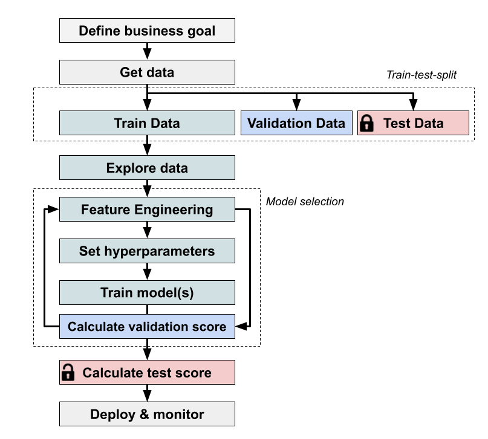

# Der Machine-Learning-Workflow

Foto von Campaign Creators auf Unsplash.

## Ziel des Machine Learnings

Das Ziel des Machine Learnings ist es, ein Machine-Learning-Modell zu erstellen, das Daten nutzt, um **uns bei Entscheidungen zu helfen**, Fragen zu beantworten oder Probleme zu lösen.

## Der Workflow

### Schritt 1: Geschäftsziel oder Forschungsfrage festlegen

Der erste Schritt in jedem Data-Science-Projekt ist, **ein klares, spezifisches und messbares Ziel festzulegen**, das zu den übergeordneten Geschäfts- oder Forschungszielen passt. Bevor du weitermachst, solltest du prüfen, ob Machine Learning der am besten geeignete Ansatz ist, denn in manchen Fällen können einfachere Alternativen wirksamer sein. Außerdem solltest du sicherstellen, dass du genügend „hochwertige“ Daten hast, um ein zuverlässiges Modell zu trainieren, denn Verfügbarkeit und Qualität der Daten beeinflussen seine Leistung erheblich. Du solltest auch klare Erfolgskriterien festlegen, an denen du erkennst, wann das Modell ausreichend verfeinert ist.

Ein gut definiertes Ziel könnte zum Beispiel so lauten:

> **Entwickle ein Vorhersagemodell**, das die Zahl der benötigten Fahrräder an jeder Station zu verschiedenen Tageszeiten mit einem mittleren absoluten Fehler (MAE) von weniger als zwei Fahrrädern schätzt und dabei Variablen wie Tageszeit, Wochentag, Wetterbedingungen und so weiter nutzt.

### Schritt 2: Daten beschaffen

Jetzt, da deine Ziele feststehen, ist es Zeit, **die Daten zu sammeln**, die du brauchst. Bezieh sie zunächst aus zuverlässigen Datenbanken, APIs und öffentlichen Datensätzen oder lies relevante Websites per Scraping aus. Konzentrier dich darauf, alle für dein Projekt entscheidenden Attribute zu erfassen, damit die Daten vollständig und für deine Machine-Learning-Modelle relevant sind.

### Schritt 3: Aufteilung in Trainings-, Validierungs- und Testdaten

Nachdem du deine Daten gesammelt hast, solltest du **den Datensatz** in drei getrennte Teile **aufteilen**: **Trainingsdaten**, **Validierungsdaten** und **Testdaten**. Diese Aufteilung ist entscheidend, um ein robustes Machine-Learning-Modell zu entwickeln.

Mit dieser Aufteilung stellst du sicher, dass du die Leistung deines Modells auf nicht gesehenen Daten zuverlässig beurteilen kannst. So funktioniert es:

- **Trainingsdaten**: Das ist der Hauptteil deines Datensatzes, mit dem du dein Modell trainierst. Das Modell lernt aus diesen Daten und passt dabei seine Parameter so an, dass es die Daten möglichst genau abbildet.
- **Validierungsdaten**: Nutz diesen Teil, um Hyperparameter, Optionen für die Vorverarbeitung und Modellfamilien auszuwählen. Die Modellparameter werden auf den Trainingsdaten angepasst, nicht auf den Validierungsdaten. Auch wiederholtes Anpassen an die Validierungsergebnisse kann zu Overfitting führen.
- **Testdaten**: Diese Daten verwendest du erst im letzten Schritt deines Workflows. Dieser Teil ist entscheidend, weil er für das Modell als neue, nicht gesehene Daten dient und so simuliert, wie das Modell in der realen Welt abschneiden wird. Nachdem alle Anpassungen und die Auswahl mit dem Trainings- und dem Validierungsdatensatz erfolgt sind, liefern dir die Testdaten eine abschließende Evaluation, an der du siehst, wie gut dein Modell voraussichtlich auf Daten abschneidet, die es noch nie gesehen hat.

### Schritt 4: Datenexploration

Erkunde nur die Trainingsdaten. Fitte Imputer, Scaler, Encoder und Regeln zur Feature-Auswahl
auf den Trainingsdaten und verwende sie dann für die zurückgehaltenen Daten wieder. Eine Pipeline innerhalb
der Kreuzvalidierung fittet diese Schritte in jedem Trainings-Fold separat neu.

Die Kreuzvalidierung kann einen eigenen Validierungsdatensatz ersetzen, braucht aber trotzdem einen
unberührten Testdatensatz für die abschließende Evaluation. Teil die Daten nach Zeit oder Entität auf, wenn zufällige
zeilenweise Aufteilungen zukünftige Informationen oder zusammengehörige Beobachtungen vermischen würden.

Bevor du mit der Modellierung beginnst, ist eine explorative Datenanalyse (EDA) entscheidend. Dieser Schritt hilft dir, die Struktur der Daten zu verstehen, Ausreißer zu erkennen und Zusammenhänge zwischen Variablen zu erkunden. Zur EDA gehört auch, die Daten zu bereinigen, damit deine Analysen korrekt sind. Hier ist eine Checkliste, die dich durch den Prozess führt:

- **Grundlagen verstehen**
  - Datentypen prüfen (kategorial, numerisch).
  - Grundlegende Kennzahlen und Verteilungen untersuchen.
- **Auf fehlende Werte prüfen**
  - Fehlende Daten erkennen.
  - Über den Umgang entscheiden (imputieren oder entfernen).
- **Nach Duplikaten suchen**
  - Doppelte Einträge finden.
- **Ausreißer erkennen**
  - Ausreißer mit Plots und Kennzahlen erkennen.
  - Über Entfernen oder weitere Untersuchung entscheiden.
- **Datenqualität beurteilen**
  - Konsistenz und Korrektheit der Daten sicherstellen.
  - Format- oder Eingabefehler korrigieren.
- **Daten visualisieren**
  - Visualisierungen für Verteilungen und Zusammenhänge erstellen.
  - Histogramme, Boxplots und Streudiagramme verwenden.
- **Korrelationsanalyse**
  - Korrelationen zwischen Variablen prüfen.

### Schritte 5, 6, 7 und 8

Wie die Abbildung oben zeigt, arbeiten die Schritte **Feature Engineering**, **Hyperparameter-Tuning**, **Modelltraining** und **Berechnung des Validierungs-Scores** in einer iterativen Schleife innerhalb des Machine-Learning-Workflows zusammen. In dieser iterativen Schleife kannst du das Modell durch wiederholte Anpassungen und Evaluationen laufend verfeinern.

Im Schritt **Feature Engineering** erstellst oder transformierst du Features auf Grundlage von Domänenwissen und der ersten Datenanalyse. Wenn du aus der Modellleistung und dem Feedback der Validierung neue Erkenntnisse gewinnst, kannst du zurückgehen und Features anpassen oder neue erstellen.

Bevor das Modell trainiert wird, müssen die **Hyperparameter** (die den Lernprozess und die Struktur des Modells steuern) festgelegt werden. Eventuell musst du sie anpassen, wenn das Modell auf den **Validierungsdaten** nicht wie erwartet abschneidet. Sobald die **Features** feststehen und die **Hyperparameter** konfiguriert sind, wird **das Modell** auf den **Trainingsdaten** **trainiert**. In diesem Schritt werden die **Modellparameter** (Gewichte, Biases usw.) an die Daten **angepasst**. Nachdem das **Modell** trainiert ist, wird es mit dem **Validierungsdatensatz** **beurteilt**.

#### Baseline-Modell

**Vor dem Start** des iterativen Prozesses ist es jedoch entscheidend, einen **klaren Ausgangspunkt** **festzulegen**. Eine Strategie ist, Methoden zu recherchieren, die andere erfolgreich implementiert haben, sie anzupassen und zu versuchen, sie zu verbessern, um bestehende Lösungen zu übertreffen. Ein anderer Ansatz ist, ein **einfaches Baseline-Modell** zu entwickeln, das als Benchmark dient, den komplexere Modelle übertreffen sollen. Ein Baseline-Modell ist in der Regel **leicht zu implementieren**. Es beruht oft auf Domänenwissen oder grundlegenden Annahmen, die sich schnell in Vorhersageregeln umsetzen lassen. Für das Beispiel mit dem Fahrradverleih könnte ein einfaches heuristisches Modell etwa so aussehen:
> Fällt der Zeitpunkt in die Stoßzeiten, sag die Zahl der benötigten Fahrräder anhand der durchschnittlichen Nachfrage vorher, die in vergangenen Stoßzeiten beobachtet wurde. Liegt der Zeitpunkt außerhalb der Stoßzeiten, sag die Zahl der benötigten Fahrräder anhand der durchschnittlichen Nachfrage vorher, die in vergangenen Zeiten außerhalb der Stoßzeiten beobachtet wurde.

### Schritt 9: Test-Score berechnen

Schreib die gewählten Features, das Vorverarbeitungsrezept, die Hyperparameter und die Metrik fest.
Trainiere die vollständige Pipeline auf den Trainings- und Validierungsdaten neu und evaluiere sie dann
einmal auf dem unberührten Testdatensatz. Mit Kreuzvalidierung und `refit=True`
trainiert eine Suche in scikit-learn ihre beste Pipeline bereits auf allen Daten neu, die an
`fit` übergeben werden. Tune anhand des Testergebnisses nichts mehr.

Gib die Grenzen dieser Schätzung an: Stichprobengröße, Abdeckung der Grundgesamtheit, mögliche
Verschiebung der Verteilung und die Kosten verschiedener Fehler. Ein hoher Test-Score ist
für sich allein noch kein Beleg dafür, dass ein Deployment angemessen ist.

### Schritt 10: Bereitstellen & überwachen

Sobald das Modell die geschäftlichen Anforderungen erfüllt, ist es bereit für das Deployment in Produktion. Im laufenden Betrieb ist es entscheidend, sicherzustellen, dass die Leistung des Modells nicht nachlässt. Dafür ist kontinuierliches Monitoring nötig, und du solltest ein Alarmsystem einrichten, das dich bei Leistungseinbrüchen benachrichtigt. Wenn die Leistung sinkt, musst du eventuell mehr Daten sammeln und das Modell neu trainieren.
